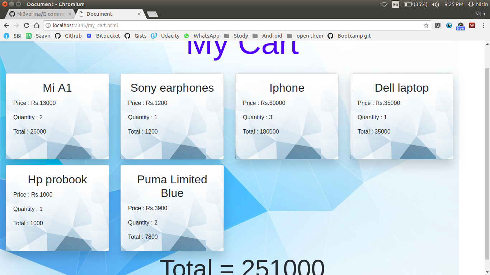

# E-commerce Website

A simple Node.js, Express, Sequelize, and MySQL shopping-cart application.



## Screenshots

- [Login](screenshots/login.png)
- [Catalog](screenshots/catalog.png)
- [Add Product](screenshots/add_product.png)
- [My Cart](screenshots/my_cart.png)

## Prerequisites

- Node.js and npm
- MySQL Server
- A MySQL user with permission to use the `shopdb` database

## Database setup

Create a database and user, or update the connection settings in `db.js`:

```sql
CREATE DATABASE shopdb;
CREATE USER 'nitin'@'localhost' IDENTIFIED BY 'system';
GRANT ALL PRIVILEGES ON shopdb.* TO 'nitin'@'localhost';
FLUSH PRIVILEGES;
```

The application uses these default values:

- Database: `shopdb`
- Username: `nitin`
- Password: `system`
- Host: `localhost`

## Installation

Open a terminal in this project folder and run:

```bash
npm install
```

## Running the application

Start the server with:

```bash
npm start
```

Open `http://localhost:2345` in a browser.

Sequelize automatically creates or updates the required tables when the server starts.

## Adding products

Sign up with the username `admin`. Logging in with this username redirects you to the Add Product page.

## Troubleshooting

- If database connection fails, verify that MySQL is running and that the credentials in `db.js` are correct.
- Create the `shopdb` database before starting the application.
- Run the server from this project folder so Node.js can find `package.json`, `server.js`, and `public`.

## Limitations

- Image upload is not implemented.
- Authentication is basic and unsuitable for production.
- Authorization and security checks are missing.
